<picture>
  <source media="(prefers-color-scheme: dark)" srcset="banner-dark.svg">
  <source media="(prefers-color-scheme: light)" srcset="banner-light.svg">
  
</picture>

## About me

I'm a full stack developer from Brazil. I build web applications with TypeScript and Python, and in my spare time I write tools for things I use every day, from a Linux driver for my motherboard's RGB to an overlay app for streaming Tibia.

<!-- TODO: uma linha sobre o trabalho atual. Ex.: "Currently building <produto> at <empresa>, working on <o que você faz>." -->

**Languages:** English · Português

## Featured projects

**[Tibia Scarab Eye](https://github.com/augustcaio/tibia-scarab-eye)** · C# 
Crops parts of the Tibia client (minimap, action bar, item slots) into overlays near the center of the screen and mirrors them into OBS for live streams. Ships with a Windows installer.

**[aorus-rgb](https://github.com/augustcaio/aorus-rgb)** · Python 
Controls the RGB lighting of the Gigabyte B550M Aorus Elite (ITE IT5702) and ENE RAM modules on Linux. Packaged for Arch Linux and runs as a systemd user service.

**[dev-env-skin](https://github.com/augustcaio/dev-env-skin)** · Lua 
My Kanagawa setup for VS Code, WezTerm, Starship and Obsidian. The banner above uses the same palette.

## Tech stack

**Front-end:** TypeScript, React, Next.js, Angular, Tailwind CSS 
**Back-end:** Node.js, Python, FastAPI, Flask 
**Mobile:** Flutter, Android Studio 
**Desktop:** C# 
**Others:** Docker, Git, Linux

## Contact

